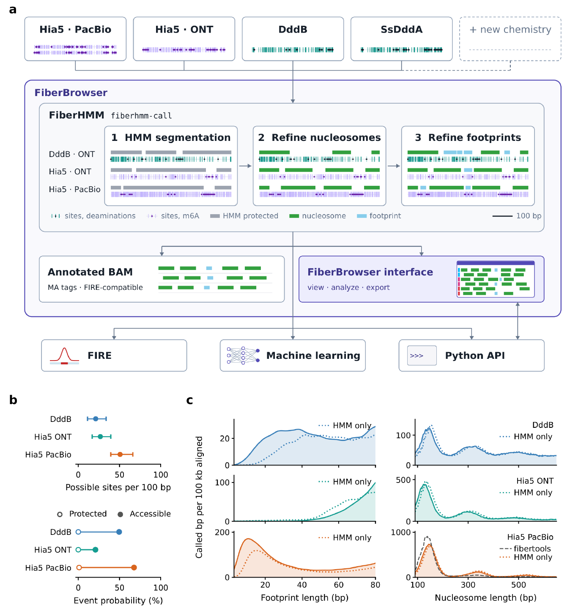
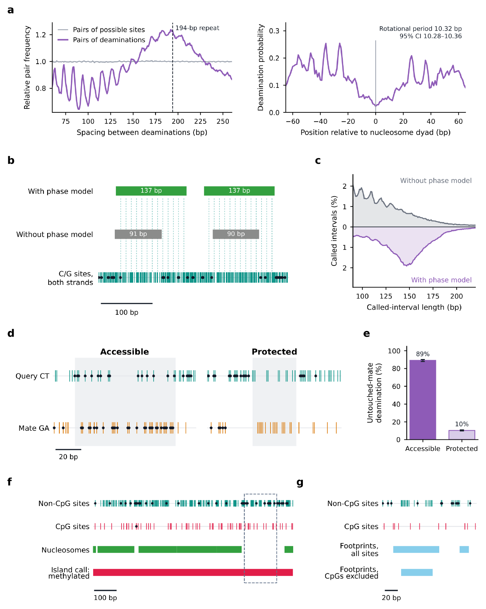

# How FiberHMM calls DAF-seq footprints

This page explains how [FiberHMM](fiberhmm.md) turns deamination patterns into nucleosomes, accessible patches and transcription-factor footprints, and what is specific to DAF-seq. It follows the [FiberBrowser and FiberHMM preprint](https://www.biorxiv.org/content/10.64898/2026.10.29.762797v1); the figures are from it.

## One representation for every assay

FiberHMM describes each molecule by the sites where the assay can report a modification and the modifications observed there. For DAF-seq the sites are the cytosines (C-to-T) or guanines (G-to-A) of one strand, and the modification is a deamination. Assays differ in how dense these sites are and how strongly accessible and protected DNA differ: PacBio Hia5 Fiber-seq reports about 50 possible sites per 100 bp because it reads modified adenines on both strands, roughly twice the density of single-strand methods such as DAF-seq. The caller has to account for this, so short protected stretches are only called where the data can support them.

*Fig. 1 of the preprint. **a**, Each chemistry is processed by `fiberhmm-call` in three steps, shown on one real 600-bp window per assay: HMM segmentation into protected (gray) and accessible DNA, nucleosome refinement at linkers (green) and footprint refinement (sky blue). Ticks, informative sites; black dots, deaminations; purple dots, m6A. **b**, Possible sites per 100 bp and event probabilities in protected and accessible DNA per assay. **c**, Footprint- and nucleosome-length distributions; dotted curves, HMM segmentation alone (DddB: 86,591 molecules from 22 Drosophila amplicon libraries).*

## The three calling steps

1. **HMM segmentation.** A two-state hidden Markov model splits each molecule into protected domains and accessible methylase-sensitive patches (MSPs). Its emission probabilities depend on the sequence context of each site, which corrects the large context bias of the deaminase.
2. **Nucleosome refinement.** Long protected domains are split at internucleosomal linkers where accessible evidence supports a break, giving individual nucleosomes with conservative edges.
3. **Footprint refinement.** Within accessible DNA, short protected intervals are scored by how unlikely their missing deaminations would be if the DNA were accessible (a log-likelihood ratio, LLR). Intervals are called at LLR 5, the lowest integer threshold at which calls in accessible controls stay below 2% for every chemistry. In simulations, DddB recovered 87% of 40-bp protected targets at this threshold.

For DddB, emission probabilities come from naked-DNA and untreated controls, and nucleosomes are called with the standard refiner: DddB shows little deamination inside nucleosomes at the enzyme concentrations used.

## SsDddA: rotational phasing inside nucleosomes

SsDddA, used in single-cell DAF-seq (scDAF-seq), deaminates not only accessible DNA but also specific positions within nucleosomes. The distance between deaminations on a molecule, and the deamination rate around nucleosome dyads, both oscillate with a 10.3-bp period, the helical repeat of DNA on the histone surface. A plain HMM reads these internal events as linkers and breaks nucleosomes into fragments.

FiberHMM instead finds nucleosome cores with relaxed emission probabilities and keeps the deaminations that fit the rotational phase inside the particle. This gives individual, mononucleosome-sized calls while keeping the accessible flanks. Across 20,915 molecules it doubled the number of called intervals per kilobase, mostly by resolving long merged intervals into separate nucleosomes. Adjacent same-strand SsDddA targets tend to convert together, so FiberHMM counts each such run once. `fiberhmm-call --enzyme ddda` applies all of this by default.

*Fig. 2 of the preprint. **a**, Deamination-to-deamination spacing (left) and deamination probability around inferred nucleosome dyads (right): rotational period 10.32 bp. **b**, One scDAF-seq molecule called without and with the phase model. **c**, Called-interval lengths for 20,915 molecules without and with the phase model. **d**, Physical duplexes with an accessible and a protected query interval (teal/amber, C-to-T and G-to-A sites; black dots, deaminations). **e**, Deamination on the untouched partner strand in accessible and protected windows across 12 libraries. **f**, Whole-island methylation inference for one molecule across an 890-bp CpG island (1/15 CpGs and 32/55 non-CpG cytosines deaminated). **g**, Footprints in the dashed window of f, called with all sites and with CpGs excluded.*

## Duplex calibration and calling

SsDddA has no usable naked-DNA control: fully accessible DNA accumulates too many uridines to amplify. FiberHMM therefore calibrates its accessible- and protected-state probabilities on physical duplexes from scDAF-seq, in which the separately amplified C-to-T and G-to-A strands of one fiber are both sequenced. The two strands are deaminated and read independently, so an interval called accessible or protected on one strand is a fixed window in which to measure deamination on its partner: 89% of partner-strand sites were deaminated in accessible windows, against 10% in protected windows, consistently across 12 libraries.

Pairing the strands is the hard part. Heterozygous variants identify a strand's haplotype, but sequence alone often cannot decide which read is the mate. `fiberhmm-pair` pairs strands by their nucleosome patterns, using deamination-insensitive sequence differences where they exist; where sequence could identify the mate independently, the two agreed 96% of the time. Calling both strands of a duplex together fills each strand's gaps with its partner's sites and more than doubles the recovery of short footprints.

## CpG methylation

SsDddA deaminates methylated CpGs less readily, so methylated CpGs can stay undeaminated even when no protein is bound. The effect is too weak to call methylation at single CpGs, but strong enough to classify whole CpG islands. `fiberhmm-tag-m5c` segments each molecule with CpGs masked, then compares CpG with non-CpG deamination within the island's accessible patches: the non-CpG rate sets the molecule's own accessible baseline, and the CpG outcomes are scored against methylated and unmethylated models. Genome-wide, unmethylated island calls agreed with long-read CpG methylation at 99.9% precision.

For footprint calling, FiberHMM treats CpGs as methylated by default and uses their deaminations only inside islands called unmethylated, so an undeaminated methylated CpG is never read as protection. The commands are on the [FiberHMM page](fiberhmm.md#usage).

## Inserted sequence

Bases inside insertions and soft clips have no reference base to compare against, so FiberHMM masks them as no evidence rather than counting them as protected. For insertions seen in several molecules, it builds a deamination-aware consensus of the inserted sequence and calls footprints across it. [FiberBrowser](fiberbrowser.md) uses the same consensus when it expands an insertion, so the chromatin inside a non-reference insertion can be viewed and analysed.

## Cite

> Tullius, T. W., Catalano, C., Ranchalis, J., Hu, J., Vollger, M. R., Stergachis, A. B., & Levine, M. S. (2026). FiberBrowser: a unified framework for single-molecule genomics. *bioRxiv*. [https://doi.org/10.64898/2026.10.29.762797](https://doi.org/10.64898/2026.10.29.762797)
