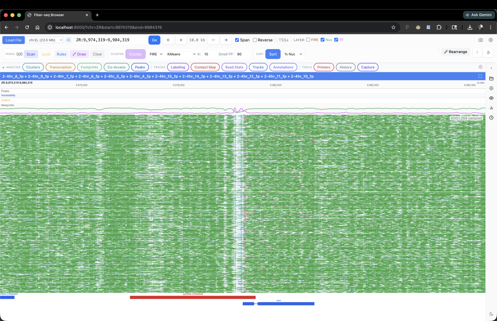
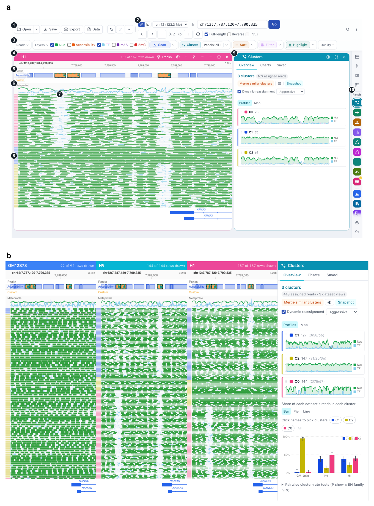

# FiberBrowser

FiberBrowser is an interactive, single-molecule-genomics-focused genome
browser for DAF-seq, Fiber-seq, and a variety of other genomic datatypes.
It is the visualization component of the
[FiberHMM](https://github.com/fiberseq/FiberHMM) pipeline, but does not
require footprints to be useful. FiberBrowser and FiberHMM are described in
our [bioRxiv preprint](https://www.biorxiv.org/content/10.64898/2026.10.29.762797v1). It allows fast and convenient exploration
and quantitative analysis of per-read footprinting and
methylation/deamination patterns across 1000s of reads, providing extensive
functionality missing from modern browsers which focus on aggregate
short-read tracks.

*2-4 hr Fiber-seq at the* eve *locus in Drosophila embryos. 1,259 reads span
the region; the browser draws every footprint on every read, and every
downstream analysis is computed on the full read set.*

## Features

- **Per-read heatmaps** of m6A / DAF accessibility, drawn as a single canvas
  layer so loci with thousands of reads stay responsive.
- **Single-molecule clustering** on CRE accessibility patterns, with
  per-cluster metaprofiles, merge / reorder / hide controls, and a sortable
  read table.
- **Direct comparison across perturbations or timepoints** -- load multiple
  datasets at once and joint-cluster them so the same single-molecule state
  definitions apply across conditions, making perturbation effects readable
  at single-read resolution.
- **Customizable footprint labeling** -- recolor footprints by user-defined
  rules (Pol II, NFR, TF, nucleosome) using size and overlap criteria.
- **Transcription-state quantification** -- filter and count reads matching
  paused, PIC, elongating, or hyperbound Pol II configurations at a
  selected gene.
- **Footprint inspection and motif enrichment** -- pull motif hits and
  FASTA for any single footprint and compare to references (ChIP-nexus,
  motif databases).
- **DAF-seq primer design** -- design and BLAST-check primers for targeted
  DAF-seq amplicons directly from the browser, with IDT / Twist CSV export.
  See also the [Primer Design](../protocol/primer-design.md) guidelines.
- **Headless / API mode and Jupyter control** -- drive the browser
  programmatically via its FastAPI endpoints or a Python client; load
  regions, pull cluster assignments, fetch co-accessibility matrices, and
  render figures directly from a notebook.
- **Local LLM copilot** (optional) -- natural-language commands that drive
  the browser via a model running on your machine (MLX on Mac, Ollama
  elsewhere); doubles as an interactive tutorial for discovering features.
- ...and more.

FiberBrowser sits downstream of the [DAF-QC Pipeline](daf-qc.md): once you
have QC'd reads and called footprints, FiberBrowser is where you explore
them.

## In the preprint

*Fig. 3 of the [preprint](https://www.biorxiv.org/content/10.64898/2026.10.29.762797v1). **a**, The interface with one H1 Fiber-seq dataset at NANOG: (1) file and session controls, (2) locus and panel navigation, (3) the toolbar of molecule operations, (4) the dataset panel header, (5) peak and custom-feature tracks, (6) the nucleosome and footprint metaprofile, (7) molecule rows drawn from their FiberHMM calls, (8) the cluster-membership strip, (9) the Clusters panel and (10) the rail that opens analysis panels. **b**, Joint clustering of lymphoblastoid and embryonic stem cell Fiber-seq at the NANOG promoter and an enhancer, with each dataset's share of each cluster.*

How FiberHMM produces the calls FiberBrowser shows for DAF-seq is explained in [How FiberHMM calls DAF-seq](daf-footprinting.md).

## Get FiberBrowser

FiberBrowser is open source (MIT) at
[github.com/fiberseq/FiberBrowser](https://github.com/fiberseq/FiberBrowser).

- **Mac app** (Apple silicon, macOS 14+): download the `.dmg` from
  [Releases](https://github.com/fiberseq/FiberBrowser/releases). It bundles
  Python, FiberHMM, minimap2 and BLAST+.
- **Windows app** (Windows 10 2004+ or 11): run the `Setup.exe` from
  [Releases](https://github.com/fiberseq/FiberBrowser/releases).
- **Command line** (macOS, Linux or WSL; Python 3.10+):
  `pipx install "fiberbrowser[app]"`, then run `fiberbrowser`. This also
  installs FiberHMM from PyPI.

The [documentation](https://github.com/fiberseq/FiberBrowser/blob/main/docs/index.md)
covers installation, a tutorial and the user guide.

## Cite

If you use FiberBrowser or FiberHMM, please cite:

> Tullius, T. W., Catalano, C., Ranchalis, J., Hu, J., Vollger, M. R., Stergachis, A. B., & Levine, M. S. (2026). FiberBrowser: a unified framework for single-molecule genomics. *bioRxiv*. [https://doi.org/10.64898/2026.10.29.762797](https://doi.org/10.64898/2026.10.29.762797)
