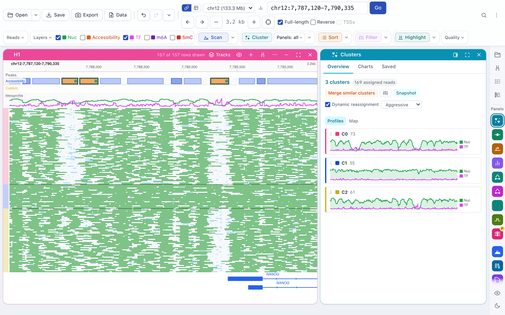

# FiberBrowser

FiberBrowser is an interactive genome browser for single-molecule chromatin data: Fiber-seq (m6A, PacBio or Oxford Nanopore) and DAF-seq (deamination, DddB or SsDddA). Most browsers summarise reads into coverage tracks. FiberBrowser draws every molecule as its own row, with its nucleosomes, transcription-factor and other small footprints, accessible DNA and base modifications, and lets you analyse those molecules as a population: cluster them, compare datasets, split them by haplotype or allele, and export figures and the numbers behind them.

It does not need footprint calls. Open any Fiber-seq or DAF-seq BAM and FiberBrowser draws each molecule's raw modification pattern, its m6A, 5mC or deamination marks, so you can explore data before calling footprints or without calling them at all. When footprints have been called, by [FiberHMM](fiberhmm.md), which FiberBrowser installs and runs, the nucleosome and footprint layers appear on top. FiberHMM writes its calls into the BAM as Molecular-annotation tags, so the same calls feed FiberBrowser, FIRE and your own scripts.

*H1 Fiber-seq at NANOG. Each row is one molecule, grouped into three clusters by its footprints at the selected peaks; the Clusters panel on the right shows their sizes and average profiles. From the [preprint](https://www.biorxiv.org/content/10.64898/2026.10.29.762797v1).*

## What you can do with it

- **See every molecule.** Each read is drawn with its calls, at thousands of reads per locus.
- **Work from raw marks.** Without footprint calls, explore the raw deamination or methylation patterns of each molecule directly.
- **Turn a locus into a population analysis.** Cluster molecules by their footprints at chosen peaks, compare cluster proportions across datasets with confidence intervals, and sort or filter by any footprint.
- **Find recurrent footprints.** Footprint classes groups footprints that recur at the same place across molecules and measures how often each molecule carries them; co-occupancy tests which footprints occur together on the same molecules.
- **Compare alleles on single fibers.** Split molecules by haplotype, by a variant's base, or by carriage of a structural variant, and expand an insertion to see the chromatin inside it.
- **Export.** Figures as PNG, SVG or PDF, and the per-read data behind every panel.
- **Script it.** A Python API and Jupyter integration drive the same engine.

## For DAF-seq

- **After QC.** FiberBrowser sits downstream of the [DAF-QC pipeline](daf-qc.md): open the QC'd, FiberHMM-called BAMs directly. [How FiberHMM calls DAF-seq](daf-footprinting.md) explains the calls you see.
- **Deamination marks.** **Layers › Deamination** draws the individual C-to-T and G-to-A deaminations on each molecule, under or instead of the footprint calls.
- **Runs from raw reads.** **New DAF-seq run** takes FASTQ reads (for example from a Plasmidsaurus Nanopore run) and a reference or plasmid map, and aligns, calls and opens the result.
- **Primer design.** Design and BLAST-check primers for targeted DAF-seq amplicons from the browser, with IDT and Twist order sheets. See also the [Primer Design](../protocol/primer-design.md) guidelines.

## Get started

Install, open your data and run a first analysis with the getting-started guide on the Fiber-seq site, which applies to DAF-seq as well:

- [Getting started with FiberBrowser](https://fiberseq.github.io/fiberbrowser/getting-started.html)
- [A tour of the features](https://fiberseq.github.io/fiberbrowser/features.html)

The source code and full documentation are on [GitHub](https://github.com/fiberseq/FiberBrowser); the [user guide](https://github.com/fiberseq/FiberBrowser/blob/main/docs/guide.md) covers every feature.

## Cite

If you use FiberBrowser or FiberHMM, please cite:

> Tullius, T. W., Catalano, C., Ranchalis, J., Hu, J., Vollger, M. R., Stergachis, A. B., & Levine, M. S. (2026). FiberBrowser: a unified framework for single-molecule genomics. *bioRxiv*. [https://doi.org/10.64898/2026.10.29.762797](https://doi.org/10.64898/2026.10.29.762797)
